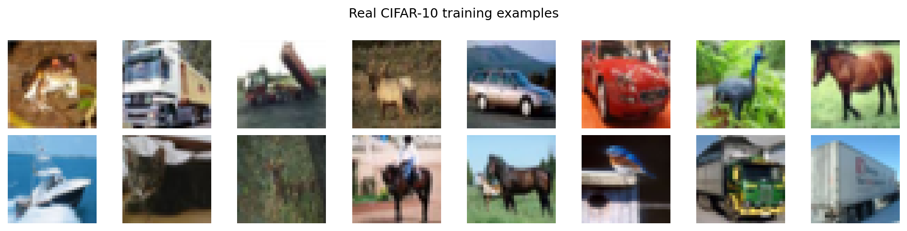
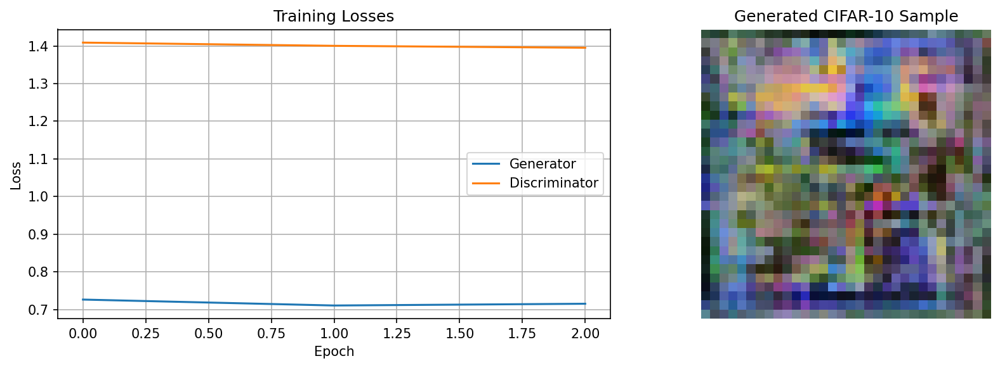
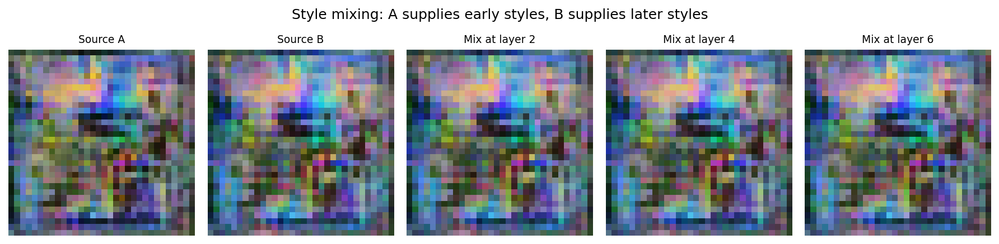

# StyleGAN-Inspired CIFAR-10 Image Generation Using TensorFlow

Exploring generative deep learning through image synthesis, training analysis, style mixing, and latent-space interpolation.

## 📌 Project Overview

This project explores a StyleGAN-inspired approach to image generation using TensorFlow and the CIFAR-10 dataset. It investigates how generative models learn image representations and synthesize new images from latent vectors.

The project includes image generation experiments, training-loss visualization, and style manipulation techniques to study the capabilities of generative models.

## ✨ Key Features

- **Image Generation:** Generate synthetic images using a GAN-based model.
- **Training Analysis:** Visualize generator and discriminator training losses.
- **Style Mixing:** Explore combinations of visual features from different latent inputs.
- **Latent Interpolation:** Investigate transitions between latent representations, if implemented in the notebook.
- **Image Visualization:** Compare real dataset samples with generated outputs.

## 🛠️ Technology Stack

- Python
- TensorFlow
- NumPy
- Matplotlib
- Jupyter Notebook
- CIFAR-10 dataset

## 🧠 Model Overview

Generative Adversarial Networks consist of two neural networks:

- **Generator:** Learns to produce synthetic images from latent inputs.
- **Discriminator:** Learns to distinguish real training images from generated images.

The two networks are trained adversarially. This project explores StyleGAN-inspired concepts for controlling and generating image variations.

## 🗂️ Project Structure

```text
Style-GAN/
├── README.md
├── StyleGAN_CIFAR10_TensorFlow.ipynb
├── requirements.txt
├── real_cifar10.png
├── style_mixing.png
└── training_results.png
```

## 📊 Experimental Results

### 1. Real CIFAR-10 Images

Examples of images from the dataset used in the experiments.



### 2. Training Results

Visualization of the training process and loss behavior.



### 3. Style Mixing

Visual results from the style-mixing experiment.



## 🚀 Getting Started

### 1. Clone the Repository

```bash
git clone https://github.com/vish-21-prog/Style-GAN.git
cd Style-GAN
```

### 2. Create a Virtual Environment (Optional)

```bash
python -m venv venv
```

Activate it on Windows:

```bash
venv\Scripts\activate
```

### 3. Install Dependencies

```bash
pip install -r requirements.txt
```

### 4. Run the Notebook

Launch Jupyter Notebook:

```bash
jupyter notebook
```

Open `StyleGAN_CIFAR10_TensorFlow.ipynb` and run the cells in order.

**Note:** Training time and results depend on the hardware, configuration, and training duration.

## 🔬 Learning Outcomes

- Understanding adversarial learning.
- Exploring image generation with deep learning.
- Analyzing generator and discriminator training behavior.
- Investigating style mixing and latent-space representations.
- Visualizing and documenting generative model experiments.

## 🔮 Future Improvements

- Improve image quality and training stability.
- Evaluate generated images using appropriate quantitative metrics.
- Experiment with larger image resolutions and datasets.
- Explore additional latent-space manipulation techniques.

## 👩‍💻 Author

**Vishalini M.**

GitHub: [vish-21-prog](https://github.com/vish-21-prog)

---

*This project is an educational exploration of StyleGAN-inspired image generation. Results depend on the implemented architecture and experimental configuration.*
